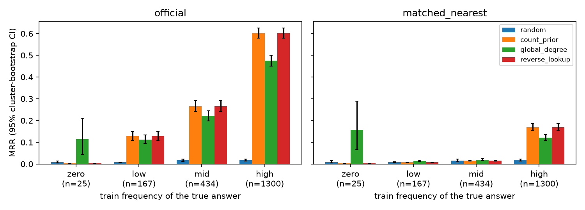

# Popularity, Leakage, or Structure?

**Team 7 · An evaluation audit of link prediction on ogbl-biokg**

On 1,926 validation queries, ranking candidates by their training frequency in the relevant relation and role produced MRR **0.4782** with official candidates and **0.1192** with nearest-frequency candidates. The paired difference was **−0.3590** (95% cluster-bootstrap interval −0.3749 to −0.3432). Changing the candidate set substantially changes how well this simple baseline performs.

[Read the six-page validation report](docs/Validation_Report.pdf) · [Обзор проекта на русском · 4 страницы](docs/Project_Overview_RU.pdf) · [Original midway report](docs/Team7.pdf) · [Result tables](results/quick) · [Open experiments](docs/Blockers.md)



## What the evidence supports

| Scorer | Official MRR | Nearest-frequency MRR | Same-bin-first MRR |
|---|---:|---:|---:|
| Random | 0.0166 | 0.0170 | 0.0165 |
| Relation/role count prior | 0.4782 | 0.1192 | 0.1356 |
| Global degree | 0.3816 | 0.0895 | 0.1006 |
| Reverse lookup + count | 0.4782 | 0.1192 | 0.1356 |
| HeadBlind, 500 updates | 0.3606 | Pending | Pending |
| TransE, 500 updates | 0.2408 | Pending | Pending |
| ComplEx, 500 updates | 0.0154 | Pending | Pending |

The sample contains at most 20 validation triples per relation (963 triples, both prediction directions). Each query has 500 typed negatives. MRR averages reciprocal ranks. For example, two correct answers ranked first and fourth give MRR (1 + ¼) / 2 = 0.625.

* **Popularity.** In nearest-frequency evaluation, 545 of 1,926 queries meet the balance criterion of at least 25% of negatives having a count at least as high as the target. Count-prior MRR on these queries is 0.00479, versus 0.01237 for random. On the other 1,381 queries the count prior reaches 0.16433. The threshold itself caps the count prior’s reciprocal rank at 1 / 63.5: at least 125 negatives tie with or outrank the target. The subset describes the matching procedure. The pooled comparison above measures sensitivity to changing the candidates.
* **Reverse lookup.** For 1,726 same-type queries, zero had an exact same-relation reverse triple in train. The other 200 cross-type queries are inapplicable. The sample therefore cannot estimate the advantage of seeing such a reverse.
* **Learned models.** Official pilot scores come from the original executed notebooks, one training seed per model. The archived data contain aggregate pilot scores. A paired learned-versus-frequency comparison requires exported weights or aligned per-query results on both protocols.

[Baseline estimates and intervals](results/quick/main_table.csv) · [Strata](results/quick/ci_by_stratum.csv) · [Paired comparisons](results/quick/paired_differences.csv) · [Pilot provenance](results/pilot_results.csv)

## Reproduce the baseline audit

From this branch in a project environment with the dependencies in `requirements.txt`:

```bash
python -m pip install -r requirements.txt
python -m pytest -q tests
python scripts/run_audit.py --download --out work/baseline-reproduction
```

For a local run use `--input-dir PATH` with the trusted OGB folder containing `split/random/train.pt`, `valid.pt` and `test.pt` (or its parent containing `biokg/`). Use original OGB files because the split format uses pickle. Test positives come from this same source and are used only to remove known positives from generated candidates. A local copy with only train and valid supports the explicitly labelled baseline ablation `--no-test-filter`. The default filtered run requires the test split. The default quick sample uses row seed 71, matched-candidate seed 2024 and 1,000 bootstrap resamples. Use a fresh output path for each run. The committed quick manifest records Python 3.13.14 on Windows and a runtime of 467 seconds. The earlier main-branch verification used a separate Python 3.14 Linux environment.

The output includes pooled metrics, stratum estimates, paired differences, a figure and a run manifest. Per-query CSVs are under `work/runs/`. The manifest records the test-mask source identity and cache checksum. Only the matched-candidate builder uses the resulting IDs to filter known positives. All scores in the report use validation queries. [Run manifest](results/quick/run_info.json)

## Score an exported pilot

1. For a Kaggle pilot, open the [bundled notebook](notebooks/C3_Kaggle_Baselines_and_Pilot_EN.ipynb). Choose pilot mode, one model and one seed. Enable the notebook's required download/install switches on a fresh Kaggle session. Keep its metric-gate output, elapsed time, selected step and scoring export.
2. Copy the selected `scoring_checkpoint.pt` to your local audit workspace. With the dataset already prepared, run:

```bash
python scripts/run_audit.py --checkpoint work/scoring_checkpoint.pt
```

Repeat `--checkpoint PATH` to compare additional models. The CLI checks dataset identity and shares validation rows and candidate arrays across scorers. It writes the learned comparison to a new run directory. For an older trusted training snapshot with its original manifest and mapping, use:

```bash
python scripts/export_scoring_checkpoint.py work/best.pt work/scoring_checkpoint.pt --original-run work/original-run
```

## Compare ComplEx and HeadBlind directly (H3)

The primary validation protocol uses a different candidate rule from the historical table above. In each relation and prediction direction, it ranks entities by their training counts, giving tied counts the same rank. After removing all known positives it retains the 1,000 eligible entities closest in rank to the target. A fixed hash resolves equal distances. Candidate seeds 311, 312 and 313 each draw 500 distinct entities from that pool. Eligibility is assessed separately for each direction of a triple.

For a small pilot, export one ComplEx and one HeadBlind checkpoint using the same training seed, number of updates and budget. In the Kaggle notebook choose `PILOT_CHECKPOINT_KIND = "last"` and check that the run reached the intended step count. Use the two exported files with the same dataset:

```bash
python scripts/run_h3.py --pilot --max-per-relation 2 --input-dir /path/to/biokg --checkpoint work/complex_101.pt --checkpoint work/head_blind_101.pt
```

The paired estimate is the average of per-query differences in reciprocal rank (ComplEx minus HeadBlind). Replicates across candidate and training seeds are averaged within each query before calculating a cluster-bootstrap interval. A positive difference favours ComplEx. The pilot measures execution cost and checks the pipeline on a small sample. The full validation mode, `--full-validation`, takes the selected best scoring export from each model for training seeds 101, 202 and 303 (six `--checkpoint` arguments). For these runs set `H3_FULL_SELECTION = True` and `PILOT_CHECKPOINT_KIND = "best"` in the Kaggle notebook. Each training run must complete the same budget S. Select on official negatives, at most 200 validation triples per relation (seed 71), every max(1000, S // 5) steps and at S. Choose the earliest step attaining the highest MRR. The export links this selection to its completed last checkpoint and records the selection history. Review pilot cost before selecting the common horizon for that experiment. The protocol reports validation evidence; the locked test is a separate stage.

The [audit source](src/biokg_audit), [synthetic tests](tests), [pilot configuration](configs/kaggle_pilot.json) and [executed notebooks](evidence/original_notebooks) document the implementation and historical evidence. The report credits OGB, the original model authors and AI assistance. Full-validation estimates, multi-seed learned comparisons and a locked final test remain open.

For an existing trusted pair of selected and final training checkpoints, add `--completed-checkpoint work/last.pt` when converting `work/best.pt` with `scripts/export_scoring_checkpoint.py`. The H3 run writes its interval to `summary.json`, per-seed estimates to `per_seed.csv`, exclusion counts to `coverage.csv`, and the paired estimates used for the interval to `averaged_per_query.csv` in a new run folder.
