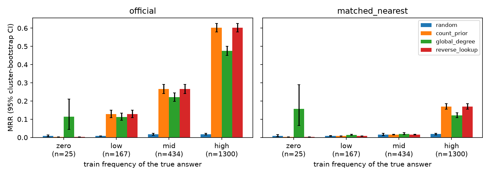

<div align="center">

# 🧬 C3 · Popularity, Leakage, or Structure?

**An evaluation audit of biomedical link prediction on `ogbl-biokg`**

*How much of a model's score comes from just predicting popular entities, and what is left once popularity is controlled?*


</div>

---

## 📌 TL;DR

On the official `ogbl-biokg` protocol, a scorer that **ignores the query entirely** and ranks candidates by how often they appear in training (the *count prior*) reaches **MRR 0.478**. That is higher than every learned model in our pilots.

When each true answer is compared against wrong answers **of similar popularity**, the count prior drops to **0.119**. For mid- and low-frequency answers it is **no better than random**.

<div align="center">



<sub>MRR by train frequency of the true answer, with 95% cluster-bootstrap CIs. Validation subset: 963 triples / 1,926 queries.</sub>

</div>

---

## 🎯 Research question and success measure

| | |
|---|---|
| **Task** | Head/tail completion on ogbl-biokg (drug, protein, disease, function, side effect; 51 relations). |
| **Question** | How much performance comes from **candidate popularity** (H1) or **reverse-edge lookup** (H2), and what do **learned scorers** add (H3)? |
| **Success measure** | A scorer captures structure beyond popularity if its MRR advantage over the count prior under **frequency-matched negatives** has a 95% CI that excludes zero, overall and in the mid/low frequency strata. |
| **Not claimed** | Any medical or clinical validity of predictions. |

---

## 📊 Results so far (validation subset)

### Baseline ladder × evaluation protocol

MRR with 95% cluster-bootstrap CIs (1,000 resamples over entity-pair clusters):

| Scorer | Uses query entity? | Official negatives | Frequency-matched negatives |
|---|:-:|---:|---:|
| Random | ✗ | 0.017 [0.014, 0.021] | 0.017 [0.014, 0.021] |
| **Count prior** (train count in relation/role) | ✗ | **0.478** [0.457, 0.498] | **0.119** [0.108, 0.130] |
| Global degree (count over all relations) | ✗ | 0.382 [0.363, 0.401] | 0.090 [0.080, 0.099] |
| Reverse lookup + count | ✓ | 0.478 (identical to count prior) | 0.119 (identical) |

### Learned pilots (official negatives only; 500 updates, seed 101; [`results/pilot_results.csv`](results/pilot_results.csv))

| Model | MRR | Hits@10 | Note |
|---|---:|---:|---|
| HeadBlind | 0.361 | 0.684 | still improving |
| TransE | 0.241 | 0.582 | still improving |
| ComplEx | 0.015 | 0.027 | at chance, under diagnosis |

### Key findings

- **H1, popularity explains most of the official score.** Under matching, count prior minus random is −0.001 [−0.007, 0.005] for mid-frequency answers and 0.000 [−0.002, 0.002] for low-frequency ones.
- **Only 28% of queries are *popularity-matchable*.** For the most popular answers, too few equally popular wrong answers remain once known true triples are filtered out. On matchable queries the count prior scores 0.005 (chance). Matched results are therefore always reported split by this flag.
- **H2, no reverse-edge leakage on this split.** None of the 1,726 same-type validation queries has its reverse triple in train, so reverse lookup adds nothing. The proposal's ~94% overlap expectation does not hold, and the effect is *not estimable*, which is different from a zero effect.

Full discussion: [`docs/Checkpoint_Report.md`](docs/Checkpoin_Report.md).

---

## 🚀 Quickstart: reproduce the main result

```bash
git clone https://github.com/mawk8/dkr-c3-biokg-audit.git && cd dkr-c3-biokg-audit
python -m venv .venv && source .venv/bin/activate     # Python 3.14 verified
pip install -r requirements.txt
pytest -q tests                                        # 10 tests, ~10 s
python scripts/run_audit.py --download                 # ~1 GB once, then ~1 min
```

Expected output: count prior MRR **0.4782** (official) → **0.119** (matched). This was verified from a fresh clone on 12 Nov 2026 with identical numbers.

| Option | Effect |
|---|---|
| `--preset full` | All 162,886 validation triples instead of 20 per relation |
| `--input-dir PATH` | Use an existing local OGB `biokg/` folder instead of downloading |
| `--no-test-filter` | Ablation: don't remove test positives from matched negatives |
| `--n-boot N` | Bootstrap resamples (default 1000) |

### Outputs → `results/<preset>/`

| File | Contents |
|---|---|
| `main_table.csv` | MRR and Hits@1/3/10 with CIs per protocol × scorer |
| `ci_by_stratum.csv` | The same split by frequency bin, matchability and direction |
| `paired_differences.csv` | Paired MRR deltas with CIs (e.g. matched − official) |
| `mrr_by_frequency.png` | Main figure (above) |
| `reverse_audit_train.csv` | Reverse-edge closure per relation in train |
| `run_info.json` | Seeds, candidate hashes, balance diagnostics, environment |

Per-query CSVs (large) are written to `work/runs/<id>/`, which is git-ignored.

### Learned-model pilots (Kaggle GPU)

HeadBlind, TransE and ComplEx are trained in [`notebooks/C3_Kaggle_Baselines_and_Pilot_EN.ipynb`](notebooks/C3_Kaggle_Baselines_and_Pilot_EN.ipynb). The notebook bundles the source, so no repo checkout is needed on Kaggle.

1. Import the notebook into Kaggle. Enable Internet, and a GPU for pilots.
2. Set `MODE`:
   - `"prepare_only"` (default) does nothing.
   - `"baselines"` runs the non-learned scorers on CPU and needs `ALLOW_DOWNLOAD=True` and `ALLOW_OGB_INSTALL=True`.
   - `"pilot"` trains one of `head_blind`, `complex` or `transe`.
3. Defaults: 128 real dimensions, 500 updates, seed 101, batch 256, 64 negatives, lr 1e-3. Settings are in [`configs/kaggle_pilot.json`](configs/kaggle_pilot.json). There is no automatic seed sweep.
4. The metric and data gates must pass. Keep the printed `completed_steps` and `stop_reason`.
5. Outputs go to `/kaggle/working/dkr_c3_en`; download them from Kaggle's **Output** panel. Keep Kaggle's preinstalled CUDA Torch and install only `ogb==1.3.6`.

---

## 🔬 Evaluation protocols

| Protocol | Negatives per query | What it tests |
|---|---|---|
| `official` | 500 uniform typed negatives provided by OGB | The leaderboard setting |
| `matched_nearest` | 500 typed negatives centred on the true answer's **popularity rank** (half less popular, half more popular when possible) | Whether a scorer still works when popularity carries no signal |
| `matched_bin` | 500 typed negatives from the same zero/low/mid/high frequency bin | Ablation of the matching rule |

All protocols use the official OGB mid-rank metric (ties count half), checked against the installed `ogb.linkproppred.Evaluator`.

Matched negatives exclude every known true triple from train, validation and test. Test head/relation/tail are read **only** for this filter, and test triples are never scored.

---

## 🗂️ Repository layout

```
├── src/biokg_audit/
│   ├── data.py          # OGB download/cache, typed global IDs, leakage audit
│   ├── baselines.py     # train-only stats; random / count / degree / reverse scorers
│   ├── matched.py       # frequency-matched negative sampler
│   ├── evaluate.py      # chunked validation evaluator, per-query + stratum export
│   ├── stats.py         # cluster-bootstrap CIs, paired differences
│   ├── training.py      # HeadBlind / TransE / ComplEx (Kaggle GPU pilots)
│   └── workflow.py      # run folders, environment capture, export
├── scripts/run_audit.py # ▶ one command to the main result
├── tests/               # pytest suite on a synthetic typed graph
├── results/
│   ├── quick/           # ▶ main result: tables, CIs, figure (from run_audit.py)
│   └── pilot_results.csv  # first-checkpoint scores incl. learned pilots
├── docs/                # checkpoint report, blockers
├── notebooks/           # Kaggle notebook for the learned-model pilots
├── evidence/            # original executed notebooks and baseline exports (read-only)
└── configs/             # pilot hyperparameters
```

---

## 🧭 Roadmap to the final report (3 Dec)

- [x] Leakage audit, official-metric parity, train-only statistics
- [x] Baseline ladder (random → count → degree → reverse)
- [x] Frequency-matched negatives with balance and matchability diagnostics
- [x] Cluster-bootstrap CIs and paired differences
- [x] One-command pipeline, pinned environment, tests, fresh-clone check
- [ ] Full-validation run (`--preset full`)
- [ ] Learned models re-scored under matched negatives (requires checkpoint export)
- [ ] ComplEx diagnosis; TransE/HeadBlind at a common horizon × 3 seeds
- [ ] Locked final test evaluation

Open issues are tracked in [`docs/Blockers.md`](docs/Blockers.md).

---

## 📚 Documents

| File | Purpose |
|---|---|
| [`docs/checkpoint-report.md`](docs/checkpoint-report.md) | Midway report: protocol, results, reverse-edge correction, AI-use statement |
| [`docs/blockers.md`](docs/blockers.md) | Outstanding work, ordered by impact |

---

<div align="center">
<sub>Course project C3 · Graph Neural Networks · Innopolis University, 2026 ·
Data: <a href="https://ogb.stanford.edu/docs/linkprop/#ogbl-biokg">OGB ogbl-biokg</a> (Hu et al., 2020) ·
AI assistance is disclosed in the checkpoint report.</sub>
</div>
