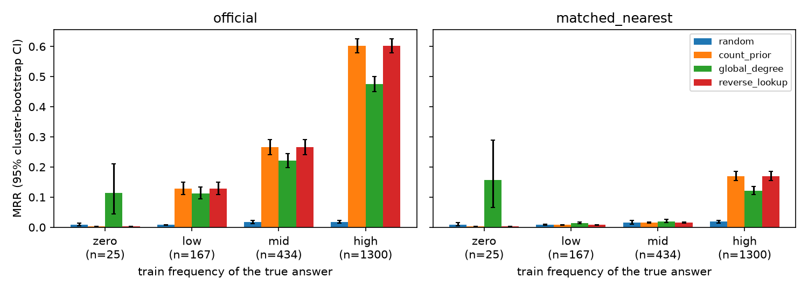

# C3 Midway Checkpoint: Biomedical Link Prediction Audit

**Date:** 12 November 2026. **Status:** preliminary validation experiments.

## Research question

How much performance on ogbl-biokg can be obtained from candidate frequency or
explicit reverse-edge lookup, and what do learned endpoint-dependent scorers add?
The project audits evaluation behaviour; it does not validate medical claims.

**Success measure.** A scorer captures structure beyond popularity if its MRR
advantage over the count prior under *frequency-matched* negatives has a 95%
cluster-bootstrap CI that excludes zero, overall and in the mid/low frequency
strata. The count prior's own drop under matching is a sanity check, not a
result: the matching is built on the same train counts.

## Data and protocol

The official train split contains 4,762,678 directed triples. Validation contains
162,886 triples. For the initial pilot we selected at most 20 validation triples
per relation with seed 71, obtaining 963 triples and 1,926 head/tail queries.
Every query retains its 500 official typed negatives. The reported pooled MRR
is for this stratified subset, not full-validation or official test MRR.

Frequency features and reverse membership use train only. The received baseline
audit reports zero exact train/validation positive overlap and zero negative
collisions against train union validation. One duplicate training row was
documented and retained. Test was not loaded, so the all-known test filter and
train/test overlap checks remain unverified.

## Preliminary results

| Scorer | Updates | Seed | Validation MRR | Hits@10 |
|---|---:|---:|---:|---:|
| Random | not trained | 101 | 0.016583 | 0.022845 |
| Count prior | not trained | n/a | 0.478156 | 0.809969 |
| HeadBlind | 500 | 101 | 0.360606 | 0.684320 |
| TransE | 500 | 101 | 0.240751 | 0.582035 |
| ComplEx | 500 | 101 | 0.015435 | 0.026999 |

Reverse lookup + count is omitted from the table: it gives identical ranks
to the count prior on every query, because no validation query has its
reverse triple in train (see the reverse-edge audit below).

Learned models use 128 real scalars per entity, batch 256, 64 typed training
negatives, Adam and learning rate 0.001. ComplEx therefore has complex rank 64.
Training used one T4. All three requested 500-update runs completed; best
checkpoints in the saved validation outputs were at update 500.

HeadBlind validation MRR increased from 0.285123 at update 250 to 0.360606 at
update 500. TransE increased from 0.212554 to 0.240751; ComplEx from 0.014701 to
0.015435. These short pilots establish execution, not convergence. None beat
Count prior in the displayed comparison. ComplEx remains near the random
baseline, requiring loss/learning diagnostics before a seed sweep or conclusions
about the scorer family. Checkpoint selection and reporting use validation,
so this is development evidence, not an independent final test.

## Evidence and precision

Baseline CSV ranks, reciprocal ranks, Hits and pooled aggregates were checked
independently from the received export. Baseline row and candidate hashes match
across methods. Full learned-run exports were not received: learned metrics
are transcribed from original executed notebooks. Their MRR values come from
checkpoint metadata; displayed Hits values are rounded to six decimals.
Shared pilot selection settings are recorded, but cross-run per-query identity
has not yet been independently verified from learned-run CSV.

## Official versus frequency-matched evaluation

Reproduce with `python scripts/run_audit.py --download` (about 1 minute after
the one-time download). Tables and figure are in `results/quick/`.

For every query we replace the 500 official negatives (uniform over the target
type) with 500 negatives of the same type whose train frequency in the same
relation/role is as close as possible to the true answer's: a window centred on
the positive's count rank, half less and half more popular where possible
(`matched_nearest`). Negatives are filtered against all known positives: train,
full validation, and test head/relation/tail (test is used only as this mask;
test triples are never scored). `matched_bin` (same zero/low/mid/high bin) is an
ablation. A global-degree prior (degree over all relations) is added because
the matching does not control it.

Same 963 triples / 1,926 queries; MRR with 95% cluster-bootstrap CIs
(1,000 resamples over entity-pair clusters):

| Scorer | Official | Matched (nearest) |
|---|---:|---:|
| Random | 0.017 [0.014, 0.021] | 0.017 [0.014, 0.021] |
| Count prior | 0.478 [0.457, 0.498] | 0.119 [0.108, 0.130] |
| Global degree | 0.382 [0.363, 0.401] | 0.090 [0.080, 0.099] |

Findings:

- Under matching, the count prior is at chance for mid and low frequency
  answers (count prior - random: mid -0.001 [-0.007, 0.005], low 0.000
  [-0.002, 0.002]).
- Its remaining 0.119 comes almost entirely from the high stratum. Only 545 of
  1,926 queries (28%) are *popularity-matchable*, meaning at least 25% of
  negatives are as popular as the positive. For the rest, the most popular true
  answers have too few more-popular entities left once known positives are
  filtered out. On matchable queries the count prior scores 0.005 (chance).
  Every matched result is therefore reported split by this flag.
- Global degree ranks below the count prior under both protocols. It beats the
  count prior only for the 25 zero-frequency answers (+0.153 [0.062, 0.285]),
  a small cell.
- These baselines set the bar for learned models. On the official protocol the
  bar is 0.478. On matched negatives it is 0.119 overall and about 0.005 on
  matchable queries.

## Reverse-edge audit: correction to the proposal

All 1,726 sampled same-type validation queries had no reverse triple in train;
200 cross-type queries were not applicable. Count prior and Reverse lookup had
identical ranks and ties for every baseline query, not merely rounded MRR.
The saved diagnostics report reverse closure within each same-type training
relation. Together with zero train/validation overlap, this explains why reverse
lookup does not provide an additional signal here.

The proposal's independently split directions and approximately 94% overlap
expectation is not supported. The exact split-generation algorithm has not been
reconstructed. The available-versus-absent interaction is **not estimable** with
an empty available stratum; it is not a zero effect. H2 is retained as an audit
of overlap and stratum applicability. We do not create an artificial leaky split.

## Next work and incomplete commitments

The proposal's TransE/ComplEx by three-seed matrix is not complete: only seed101
pilots are available. First inspect learning/loss diagnostics and measured
resources, choose a common horizon, then run seeds 101/202/303 under that recipe.
Longer KGE runs must not be compared with HeadBlind after 500 updates as an equal-budget result.

Matched negatives, balance diagnostics and cluster-bootstrap intervals are now
implemented for the non-learned ladder (above). Remaining: run the full
validation split (`--preset full`); evaluate HeadBlind/TransE/ComplEx under
matched negatives, which needs exported checkpoints; H3; and the locked
final-test evaluation. The final report and reproducible main experiment are due 3 December.
No claim of statistical significance or clinical usefulness is made here.

## Project contribution and AI use

The implemented pipeline covers typed IDs, train-only frequency/reverse controls,
role-aware HeadBlind, TransE/ComplEx scorers, shared pilot training, official
mid-rank checks, stratified export and provenance. Model equations and benchmark
protocols come from their cited sources; these are not novel scorers.

Astra assisted research/specification and plan revision. Sol assisted code
implementation; the coordinating assistant integrated code, fixed evaluator
interop and analysed supplied evidence. Team members ran the Kaggle experiments.
All generated code and scientific interpretations remain the team's responsibility
to review and explain.

## Sources

- [Course project requirements](https://lukmanovr.github.io/dkr/project/)
- [OGB link prediction and ogbl-biokg](https://ogb.stanford.edu/docs/linkprop/#ogbl-biokg)
- [Official OGB evaluator](https://github.com/snap-stanford/ogb/blob/master/ogb/linkproppred/evaluate.py)
- [TransE, NeurIPS 2013](https://proceedings.neurips.cc/paper_files/paper/2013/file/1cecc7a77928ca8133fa24680a88d2f9-Paper.pdf)
- [ComplEx, ICML 2016](https://arxiv.org/abs/1606.06357)
- [AutoWeird, frequency-only motivation](https://arxiv.org/abs/2207.11673)
